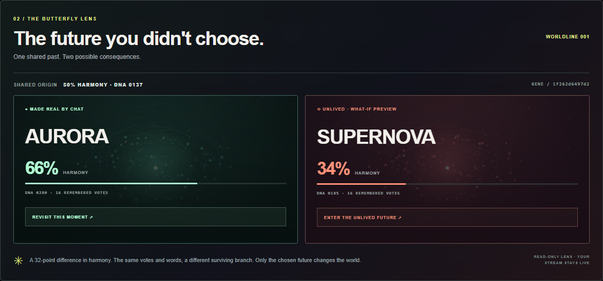
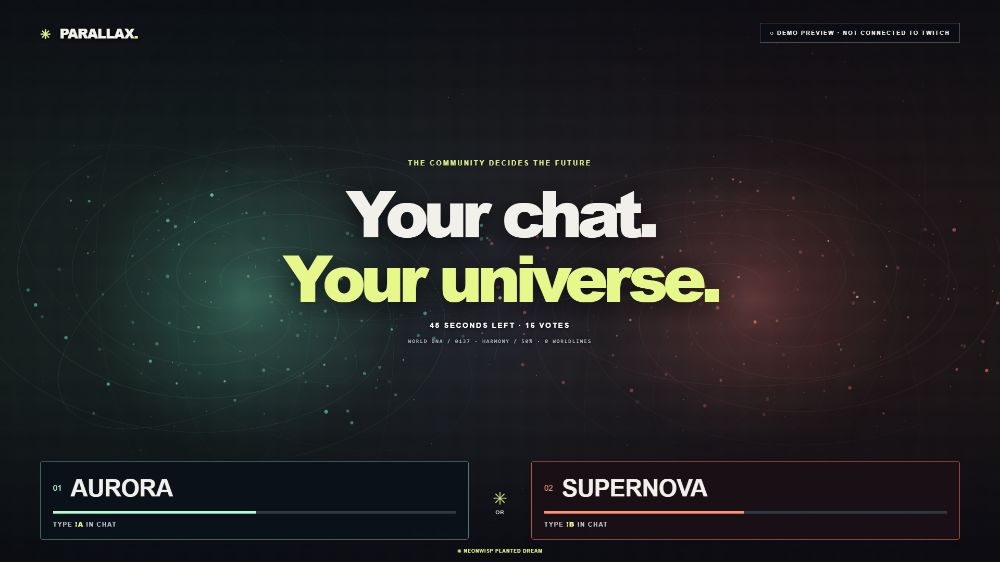

# PARALLAX

### One chat. Two futures. A world that remembers.

Turn Twitch chat into a shared universe. Viewers choose a future, contribute a word, and watch their decision reshape the world that the next round inherits. Then the **Butterfly Lens** lets them explore the future they left behind.



**Post-deadline continuation · 3 November 2026.** This separate [continuation repository](https://github.com/Enrickq/parallax-next) contains work beyond the frozen hackathon version. It has not been substituted into the entry. The submitted repository and video remain unchanged. [Version and evidence status](docs/PROJECT_STATUS.md).

## Try it in one minute

Requires **Node.js 20+**. No dependencies, build step, accounts or paid APIs are needed for the local walkthrough.

```powershell
node server.js
```

Open **[127.0.0.1:3000](http://127.0.0.1:3000/)** and:

1. **OPEN THE RIFT** to reveal two possible futures.
2. **SIMULATE 16 VIEWERS** to try the visibly labeled simulation.
3. **COLLAPSE REALITY**, then **BACK TO THE MULTIVERSE**.
4. Compare both outcomes in the Butterfly Lens and **ENTER THE UNLIVED FUTURE**.
5. **RETURN TO LIVE** and open the next round. The chosen world's consequences carry forward.

The alternate view stays local to the studio. It never rewrites the shared world or the stream overlay.

## Let chat write the next chapter

| Command | Contribution |
|---|---|
| `!a` or `!b` | Choose a future; one vote per username per round |
| `!spark hope` | Add a short word or phrase to the procedural visual seed; one contribution per username per round |

The director chooses a voting window or collapses it early. Branch A wins ties. Both outcomes use the same prior world and the latest ten spark contributions; only the winner becomes the next shared world. The latest twelve decisions can be revisited after a server restart.

To read a public channel, stop the simulation server and start it in PowerShell with:

```powershell
$env:TWITCH_CHANNEL = 'your_channel'
$env:TWITCH_ANONYMOUS = '1'
node server.js
```

This opt-in reader uses the anonymous pattern documented by tmi.js. It sends no chat messages and needs no account credentials. Confirm the studio reports a connection, open a round, and send a command from the channel's Twitch chat. Anonymous access depends on Twitch; authenticated setup is also available. [Full Twitch setup](docs/TWITCH_SETUP.md).

## Bring the world on stream



Add an OBS **Browser Source** using `http://127.0.0.1:3000/overlay`, **1920 × 1080**, **30 FPS**. Keep the director studio open in a separate window. Both receive the same shared world through Server-Sent Events.

## Built to be inspectable

- **A common origin:** the winning and unchosen outcomes are calculated before the winner commits.
- **A local lens:** historical exploration never changes server state or OBS.
- **A persistent world:** harmony, vote memory and the procedural seed carry into the next round.
- **A small runtime:** Node's standard library serves the app; browser Canvas renders the worlds.

```powershell
npm test
```

**26 behavioral tests pass in this local continuation.** They cover voting, deduplication, deadlines, paired outcomes, IRC parsing, local OAuth and HTTP director controls. They do not establish receipt of real Twitch messages. [Build provenance and verification](CODEX_BUILD_LOG.md).

Codex helped implement the paired futures, Butterfly Lens, connection handling, request validation and tests. The entrant supplied the starting prototype. Codex is the development tool; the running app uses procedural graphics rather than AI API calls.

## Explore the project

| Resource | Contents |
|---|---|
| [Twitch setup](docs/TWITCH_SETUP.md) | Public reader, existing token and local browser authorization |
| [Operation and world rules](docs/OPERATIONS.md) | Routes, storage, limits and hosting |
| [Project status](docs/PROJECT_STATUS.md) | Frozen baseline, local changes and evidence boundaries |
| [Codex build log](CODEX_BUILD_LOG.md) | Session provenance and verification |
| [Archived submission materials](docs/archive/README.md) | Original preparation documents, preserved as dated snapshots |

Built for the [Codex x TwitchCon Hackathon](https://twitchcon-codex.devpost.com/). The frozen public source is [Enrickq/parallax-twitchcon-2026](https://github.com/Enrickq/parallax-twitchcon-2026).

Released under the [MIT license](LICENSE).
